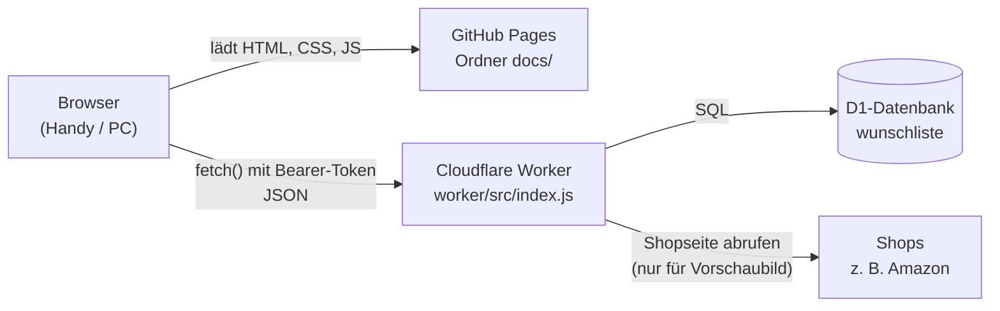
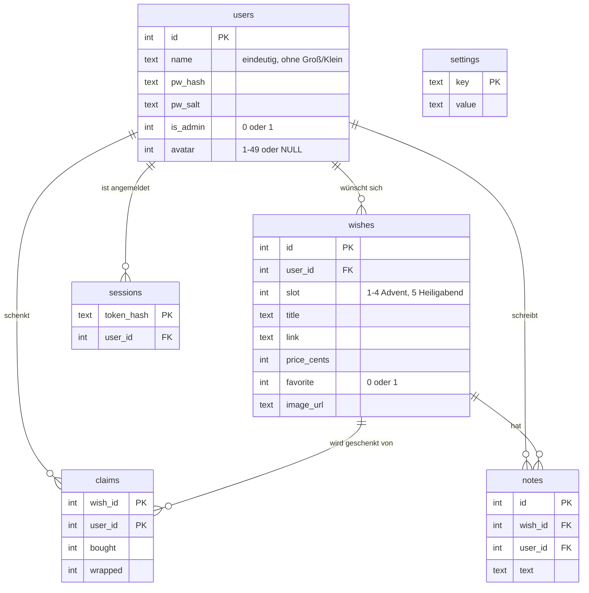
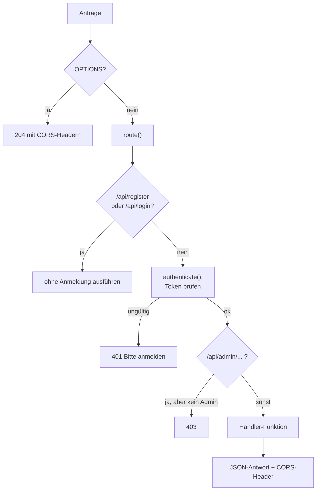
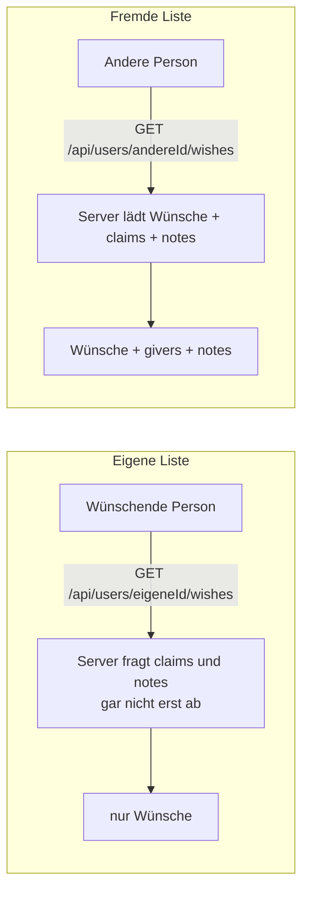

# Code-Dokumentation: Unser Wunschzettel

Diese Datei erklärt, **wie der Code aufgebaut ist und warum**. Einrichtung, Deploy und
Admin-Befehle stehen in der [README.md](README.md).

## Inhalt
1. [Überblick](#1-überblick)
2. [Ordner und Dateien](#2-ordner-und-dateien)
3. [Datenbank](#3-datenbank)
4. [Server (Worker)](#4-server-worker)
5. [API-Übersicht](#5-api-übersicht)
6. [Webseite (Frontend)](#6-webseite-frontend)
7. [Sicherheit und Geheimhaltung](#7-sicherheit-und-geheimhaltung)
8. [Vorschaubilder](#8-vorschaubilder)
9. [Avatare und Tagestexte](#9-avatare-und-tagestexte)
10. [Tests](#10-tests)
11. [Typische Änderungen](#11-typische-änderungen)
12. [Stolperfallen](#12-stolperfallen)

---

## 1. Überblick

Die Anwendung besteht aus zwei getrennten Teilen, die beide kostenlos gehostet werden:



- **GitHub Pages** liefert nur statische Dateien aus. Dort gibt es keine Logik und keine Daten.
- **Der Cloudflare Worker** ist der Server. Er prüft Anmeldungen, schreibt in die Datenbank und
  entscheidet, wer was sehen darf.
- **D1** ist eine SQLite-Datenbank bei Cloudflare.

Es gibt keinen Build-Schritt und keine Frameworks: Die Webseite ist reines JavaScript, der Worker
ebenfalls. Die einzige Abhängigkeit ist `wrangler`, das Cloudflare-Werkzeug zum Testen und Hochladen.

**Adressen**
- Webseite: `https://jrbroker.github.io/wunschzettel/`
- Server: `https://wunschliste-api.i-farenbruch.workers.dev`

---

## 2. Ordner und Dateien

| Pfad | Zweck |
|---|---|
| `docs/index.html` | Gerüst der Seite: Kopfleiste, `<main id="app">`, Schnee-Canvas, Script-Tags mit `?v=`-Version |
| `docs/config.js` | Server-Adresse. Auf `localhost` wird automatisch `http://localhost:8787` genutzt |
| `docs/app.js` | Die ganze App: API-Aufrufe, Router, alle Ansichten, Schneefall |
| `docs/avatars.js` | Erzeugt die 49 Avatar-Bilder als SVG im Code |
| `docs/texts.js` | Tagestexte für die Startseite und die Auswahl-Logik |
| `docs/style.css` | Alle Styles inkl. Handy-Ansicht |
| `worker/src/index.js` | Der komplette Server: Router, Anmeldung, Wünsche, Schenken, Notizen, Admin, Vorschaubilder |
| `worker/schema.sql` | Datenbank-Schema für eine **neue** Datenbank |
| `worker/migrations/*.sql` | Änderungen für die **bestehende** Datenbank, jeweils einmal angewendet |
| `worker/test/api.test.mjs` | API-Tests gegen den lokalen Worker |
| `worker/wrangler.toml` | Worker-Konfiguration: Name, D1-Verknüpfung, erlaubte Origins |
| `worker/.dev.vars` | Lokaler Einladungscode (nicht im Git) |
| `.githooks/pre-commit` | Setzt die Cache-Versionsnummer in `docs/index.html` |
| `.claude/launch.json` | Startbefehl für die lokale Vorschau (Port 8080) |

Nicht im Git (siehe `.gitignore`): `node_modules/`, `.wrangler/`, `.dev.vars`,
`EINLADUNGSCODE.txt`, `backups/`.

---

## 3. Datenbank



- **claims** ist die Tabelle „Ich schenke das“. Der Primärschlüssel `(wish_id, user_id)` erlaubt
  mehrere Schenkende pro Wunsch (gemeinsam schenken), aber jede Person nur einmal.
- **notes** sind die geheimen Notizen zu einem fremden Wunsch.
- **settings** enthält derzeit nur `invite_code`, sobald ein Admin den Link erneuert hat.
- **Preise** werden in Cent gespeichert (`1999` = 19,99 €), damit es keine Rundungsfehler gibt.
- **Datumsangaben** fehlen bewusst. Ein Wunsch hängt nur am `slot`, die echten Daten rechnet
  die Webseite jedes Jahr neu aus.

**Wichtig beim Löschen:** Der Code verlässt sich nicht auf `ON DELETE CASCADE`, sondern löscht
abhängige Zeilen selbst. Beispiele sind `deleteWish` und `adminDeleteUser`, die Notizen,
Markierungen, Wünsche und Sitzungen jeweils in einem `batch` entfernen. Neue Löschfunktionen
sollten das genauso machen.

---

## 4. Server (Worker)

Alles steht in `worker/src/index.js`. Der Ablauf einer Anfrage:



**Fehlerbehandlung:** Handler werfen `new HttpError(status, "Text")`. Der äußere `fetch`-Handler
macht daraus eine JSON-Antwort `{ "error": "Text" }`. Die Texte sind deutsch und werden in der
Webseite direkt als Meldung angezeigt. Unerwartete Fehler werden geloggt und als
„Interner Fehler“ (500) beantwortet.

**Code-Abschnitte in `index.js`** (in dieser Reihenfolge):

| Abschnitt | Wichtige Funktionen |
|---|---|
| Grundgerüst | `fetch`, `HttpError`, `corsHeaders`, `json`, `body`, `route` |
| Kryptografie | `hashPassword` (PBKDF2), `sha256`, `randomHex`, `timingSafeEqual` |
| Sitzungen | `createSession`, `authenticate`, `publicUser` |
| Konto | `register`, `login`, `logout`, `changeOwnPassword`, `setAvatar`, `currentInvite` |
| Admin | `adminResetPassword`, `adminRename`, `adminDeleteUser`, `renewInvite` |
| Daten | `listUsers`, `listWishes`, `parsePrice`, `validateWish` |
| Vorschaubilder | `fetchPreviewImage`, `extractImage`, `jsonLdImage`, `amazonImage`, `safeImageUrl` |
| Wünsche | `createWish`, `updateWish`, `deleteWish`, `refreshPreview`, `ownWish` |
| Schenken | `claimWish`, `updateClaim`, `unclaimWish`, `myClaims`, `foreignWish` |
| Notizen | `createNote`, `deleteNote` |

**Zwei Hilfsfunktionen für Berechtigungen:**
- `ownWish(env, me, id)` lädt einen Wunsch und bricht ab, wenn er nicht `me` gehört. Wird
  beim Bearbeiten, Löschen und für Vorschaubilder genutzt.
- `foreignWish(env, me, id, msg)` ist das Gegenteil und bricht ab, wenn es **der eigene**
  Wunsch ist. Wird beim Schenken und bei Notizen genutzt.

**Grenzen:** Titel höchstens 200 Zeichen, Links höchstens 1000, Notizen höchstens 500. Links ohne
`http(s)://` bekommen automatisch `https://` vorangestellt.

---

## 5. API-Übersicht

Alle Pfade außer Registrieren und Anmelden brauchen den Header `Authorization: Bearer <token>`.

| Methode | Pfad | Zweck |
|---|---|---|
| POST | `/api/register` | Konto anlegen mit `{invite, name, password}` |
| POST | `/api/login` | Anmelden mit `{name, password}`, liefert `{token, user}` |
| POST | `/api/logout` | Aktuelle Sitzung beenden |
| GET | `/api/me` | Eigene Daten |
| GET | `/api/invite` | Aktueller Einladungscode |
| POST | `/api/me/password` | Eigenes Passwort ändern, meldet andere Geräte ab |
| PUT | `/api/me/avatar` | Avatar wählen (1–49 oder `null`) |
| GET | `/api/users` | Alle Personen mit Avatar und Anzahl Wünsche |
| GET | `/api/users/:id/wishes` | Liste einer Person (Inhalt hängt davon ab, wer fragt, siehe Abschnitt 7) |
| POST | `/api/wishes` | Wunsch anlegen |
| PUT / DELETE | `/api/wishes/:id` | Eigenen Wunsch ändern / löschen |
| POST | `/api/wishes/:id/preview` | Vorschaubild für eigenen Wunsch holen |
| POST / PUT / DELETE | `/api/wishes/:id/claim` | Schenken / gekauft+verpackt setzen / aussteigen |
| GET | `/api/claims` | Eigene Einkaufsliste inkl. Mitschenkende |
| POST | `/api/wishes/:id/notes` | Geheime Notiz schreiben |
| DELETE | `/api/notes/:id` | Eigene Notiz löschen |
| POST | `/api/admin/invite` | **Admin:** Einladungslink erneuern |
| PUT / DELETE | `/api/admin/users/:id` | **Admin:** Person umbenennen / entfernen |
| POST | `/api/admin/users/:id/password` | **Admin:** Passwort zurücksetzen |

---

## 6. Webseite (Frontend)

`docs/app.js` ist eine einzige Funktion `(() => { ... })()`, damit nichts in den globalen
Namensraum gelangt. Die Abschnitte im Code sind mit `// ---------- name ----------` markiert.

### Router

Die Seiten werden über den Teil hinter `#` in der Adresse gewählt. Dadurch funktioniert
GitHub Pages ohne Server-Konfiguration.

| Adresse | Funktion | Ansicht |
|---|---|---|
| `#/` | `homeView()` | Begrüßung, Countdown, Tagestext, Familien-Kacheln |
| `#/liste/:id` | `listView()` → `ownList()` oder `otherList()` | Eigene bzw. fremde Wunschliste |
| `#/einkauf` | `shoppingView()` | Was ich schenke, mit gekauft/verpackt |
| `#/konto` | `accountView()` | Avatar, Passwort, Verwaltung (nur Admins), Abmelden |
| `#/einladung/:code` | `authView()` | Registrieren/Anmelden mit Einladungscode |

`route()` wird beim Laden und bei jedem `hashchange` aufgerufen. Ohne Token wird immer
`authView()` gezeigt.

### Hilfsfunktionen

- `api(method, path, body)` ruft den Server auf. Bei 401 wird die Sitzung gelöscht und zur
  Anmeldung gewechselt.
- `h(tag, attrs, ...children)` baut DOM-Elemente. Texte werden als Textknoten eingefügt und
  dadurch nie als HTML ausgeführt. So kann ein Wunschtitel wie `<script>` keinen Schaden anrichten.
- `render(...nodes)` ersetzt den Inhalt von `#app`. `null`-Einträge werden herausgefiltert,
  damit bedingte Teile wie `isAdmin && adminCard()` funktionieren.
- `slots()` berechnet die Termine des laufenden Jahres. Der 4. Advent ist der Sonntag am
  oder vor dem 24.12., die anderen liegen je 7 Tage davor. Ab dem 27.12. wird das nächste Jahr gezeigt.
- `avatar(name, avatarId)` zeigt das gewählte Avatar-SVG oder einen farbigen Anfangsbuchstaben.

### Speicher im Browser

`localStorage` enthält nur `wunschzettel-token` und `wunschzettel-user`. Alle anderen Daten
kommen bei jedem Seitenwechsel frisch vom Server.

### Cache-Versionen

Script- und CSS-Links in `index.html` tragen `?v=<Zeitstempel>`. Der Git-Hook
`.githooks/pre-commit` setzt diesen Zeitstempel neu, sobald ein Commit Dateien in `docs/`
enthält. Sonst kann ein Browser eine alte `app.js` mit einer neuen `index.html` mischen,
und die Seite bleibt leer.

---

## 7. Sicherheit und Geheimhaltung



- **Die Überraschung bleibt geheim:** In `listWishes` gibt der Server bei der eigenen Liste
  zurück, **bevor** Markierungen oder Notizen gelesen werden. Die Daten können also auch nicht
  über die Entwicklerwerkzeuge des Browsers sichtbar werden. Diese Regel darf bei Änderungen
  nicht aufgeweicht werden, und ein Test prüft sie.
- **Passwörter:** PBKDF2-SHA256 mit 100.000 Durchläufen und eigenem Salt pro Person. 100.000 ist
  das Maximum, das Cloudflare Workers erlaubt.
- **Sitzungen:** Das Token ist ein Zufallswert. In der Datenbank steht nur sein SHA-256-Hash.
  Auch wer die Datenbank sieht, kann sich also nicht anmelden.
- **Vergleiche** von Einladungscodes laufen über `timingSafeEqual`, damit sich der Code nicht
  über Antwortzeiten erraten lässt.
- **CORS:** Nur die Origins aus `ALLOWED_ORIGINS` in `wrangler.toml` dürfen die API aus dem
  Browser nutzen.
- **Einladungscode:** Steht in `settings.invite_code`, sobald ein Admin ihn erneuert hat.
  Sonst gilt das Cloudflare-Secret `INVITE_CODE`.
- **Admin** ist die Spalte `users.is_admin` und steht nicht im Code. Ein Admin kann sich nicht
  selbst entfernen.

---

## 8. Vorschaubilder

Beim Speichern eines Wunsches mit Link ruft die Webseite danach separat
`POST /api/wishes/:id/preview` auf. Getrennt ist das, weil ein langsamer oder blockierender
Shop sonst das Speichern des Wunsches verhindern könnte.

`fetchPreviewImage(link)` geht so vor:

1. Seite mit 5 Sekunden Zeitlimit abrufen. Ist der Link selbst ein Bild, wird er direkt genommen.
2. **Kopfbereich** (`<head>`) einlesen und mit `extractImage` nach `og:image`, `twitter:image`,
   `image_src` usw. suchen.
3. Ohne Treffer den **Seitenkörper Stück für Stück** nach JSON-LD-Produktdaten und Amazon-Markup
   (`data-old-hires`, `hiRes`, `landingImage`) durchsuchen. Beim ersten Treffer wird abgebrochen.

**Warum stückweise?** Cloudflare gibt einem Worker im Gratis-Tarif nur wenige Millisekunden
Rechenzeit pro Anfrage. Amazon-Seiten sind rund 2,5 MB groß und haben das Produktbild weit
unten. Die ganze Seite auf einmal zu verarbeiten, überschritt das Limit und führte zu
„Worker exceeded resource limits“. Deshalb wird pro Stück nur das neue Stück plus ein kurzer
Überhang (`carry`) durchsucht.

Manche Shops wie mobile.de, Thalia, Lego oder Etsy blockieren automatische Abrufe. Das wird
bewusst nicht umgangen. Der Wunsch wird dann ohne Bild gespeichert.

`safeImageUrl` lässt nur `https`-Adressen zu und macht aus `http` automatisch `https`, weil die
Seite sonst das Bild blockiert.

---

## 9. Avatare und Tagestexte

### `docs/avatars.js`

Setzt `window.AVATARS` (Liste mit `{id, label, kind, svg}`) und `window.avatarSvg(id)`.

| IDs | Art | Inhalt |
|---|---|---|
| 1–10 | `person` | Männer |
| 11–20 | `person` | Frauen |
| 21–40 | `animal` | Rentier, Pinguin, Eisbär, Fuchs, Eule, Hase, Katze, Hund, Igel, Maus (je 2) |
| 41–49 | `cat` | Familienkatzen: weiß mit braunen/grauen Flecken, schwarz, Silver-Tabby- und Golden-Shaded-BKH |

Alle Menschen nutzen dieselben Bausteine (`person()`, `hairBack`, `hairTop`, `beards`, Hüte),
die Katzen `catFace()` und `bkhFace()`.

> **Regel:** Die IDs sind in der Datenbank gespeichert. Neue Avatare **nur hinten anhängen**,
> nie umsortieren oder löschen. Danach `AVATAR_COUNT` in `worker/src/index.js` anpassen und den
> Worker neu deployen.

### `docs/texts.js`

Setzt `window.DAILY_TEXTS` und `window.dailyTextFor(date)`. Vorrang bei der Auswahl:
1. Sondertage (6.12., 24.12., 25.12., 26.12., 31.12.). Heiligabend schlägt den 4. Advent.
2. Adventssonntage. Ein Advent schlägt Nikolaus, wenn beide auf denselben Tag fallen.
3. Sonst einer der 40 allgemeinen Texte, reihum nach Datum gewählt. Alle sehen also am selben
   Tag denselben Text, und er wechselt um Mitternacht.

---

## 10. Tests

`worker/test/api.test.mjs` prüft die API von außen gegen den **lokalen** Worker
(`npx wrangler dev`, Port 8787). Aktuell sind es 51 Tests, darunter:

- Registrieren nur mit gültigem Einladungscode
- Die eigene Liste enthält **keine** Markierungen und Notizen
- Fremde Wünsche markieren, gemeinsam schenken, gekauft/verpackt
- Notizen nur zu fremden Wünschen, Löschen nur der eigenen
- Admin-Funktionen nur für Admins
- CORS nur für erlaubte Origins
- Abmelden macht das Token ungültig
- `extractImage` mit og:image, JSON-LD und Amazon-Markup

Die Tests brauchen ein lokales Admin-Konto (Details in der README).

```powershell
cd worker; npm test
```

Die Oberfläche hat keine automatischen Tests. Sie wird von Hand im Browser geprüft, und zwar
**immer auch als Nicht-Admin**.

---

## 11. Typische Änderungen

**Neues Feld an einem Wunsch**
1. Migration `worker/migrations/00X_name.sql` mit `ALTER TABLE wishes ADD COLUMN ...` anlegen.
2. Die Spalte auch in `schema.sql` ergänzen, damit neue Datenbanken sie haben.
3. Im Worker `WISH_COLUMNS`, `RETURN_WISH`, `validateWish` sowie die INSERT/UPDATE-Abfragen ergänzen.
4. In `app.js` Formular (`ownList`) und Anzeige (`wishMeta` / `otherList`) ergänzen.
5. Lokal anwenden und testen, dann online: Sicherung mit `wrangler d1 export`, Migration
   `--remote` ausführen, `npm run deploy`, Commit und Push.

**Nur die Webseite ändern:** Committen und pushen genügt. Der Hook setzt die Version, und
GitHub Pages ist nach etwa einer Minute aktuell.

**Nur den Server ändern:** Im Ordner `worker` `npm run deploy` ausführen, danach committen.
Ein Push allein ändert den Server **nicht**.

**Neuer API-Endpunkt:** Eine Zeile in `route()` und eine Handler-Funktion. Die Berechtigung
im Handler mit `ownWish` / `foreignWish` / `me.is_admin` prüfen.

---

## 12. Stolperfallen

| Problem | Ursache / Lösung |
|---|---|
| Seite bleibt nach Update leer | Alte Dateien im Browser-Cache. Den Hook aktivieren (`git config core.hooksPath .githooks`), notfalls Strg+F5 |
| Einladungslink ungültig, obwohl er stimmt | Beim Setzen des Secrets per PowerShell-Pipe kamen unsichtbare Zeichen mit. Mit `printf '%s' CODE \| npx wrangler secret put INVITE_CODE` aus Git Bash setzen |
| Vorschaubild fehlt | Shop blockiert, oder die Seite ist zu groß für das CPU-Limit (siehe Abschnitt 8) |
| Nach Server-Änderung passiert nichts | Worker nicht deployed: Push allein reicht nicht |
| Avatar zeigt falsches Bild | Avatar-IDs wurden verschoben. IDs nur anhängen |
| „null“ erscheint als Text | Ein Element wurde an `render` oder `h` mit `null` übergeben. `render` filtert das, `replaceChildren` direkt nicht |
| Commit-Text kaputt | PowerShell 5.1 verarbeitet Anführungszeichen in `git commit -m` falsch. Nachricht per Datei oder aus Git Bash übergeben |
